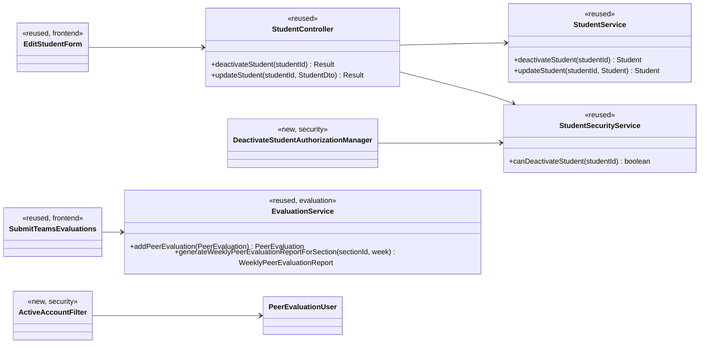
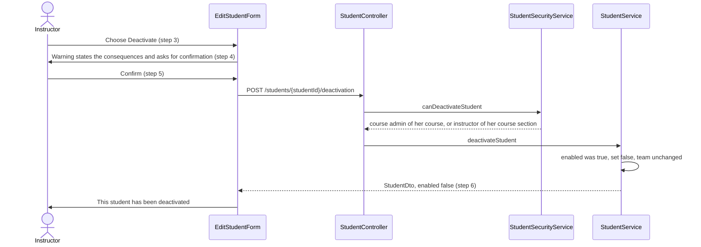
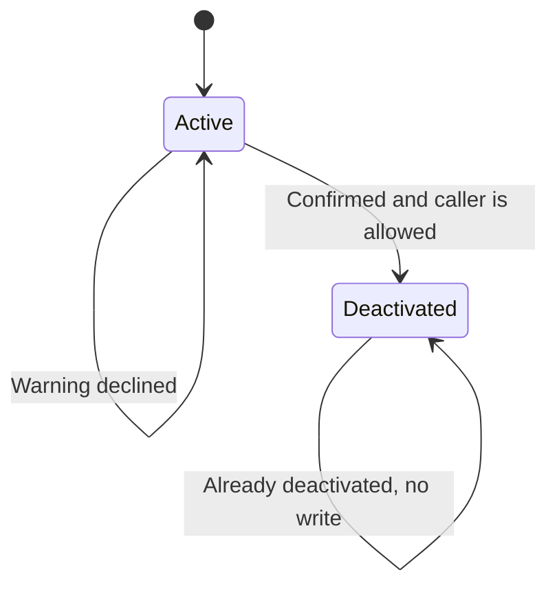
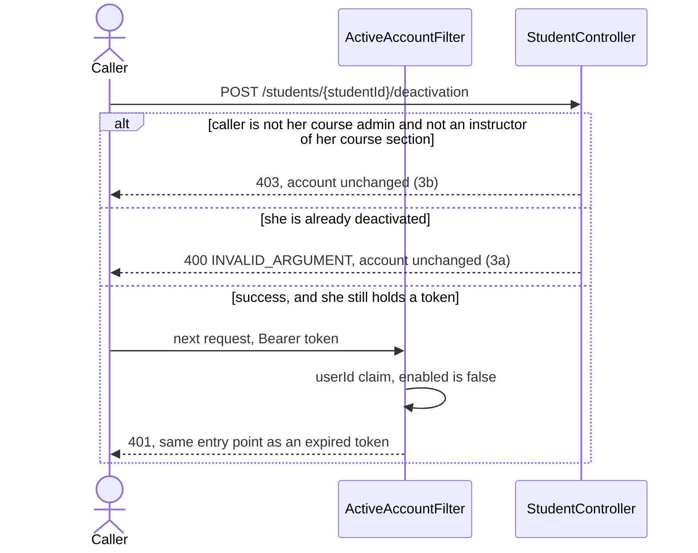

# Student (STU) Design

> Realizes: UC-STU-deactivate-student
> Depends on: FR-SEC-active-account, BR-student-lifecycle, BR-submission-owed
> See: [use cases](../requirements/use-cases.md#student), [SRS](../requirements/software-requirements-specification.md), [architectural-design.md](architectural-design.md#performance-tracking-components) (foundation component view, Crosscutting Concepts › Authorization)
> Also constrains, and does not build: UC-STU-reactivate-student. Consequences land in UC-EVA-submit-evaluation (extension 4b) and UC-EVA-section-evaluation-report.

## Overview

Deactivation is a dedicated action on an existing student, not a field of the edit form. It sets `Student.enabled` to false, leaves her team and her stored weekly activity reports and peer evaluations in place, and refuses the token she already holds. The area stays in the existing `student` package inside the REST API container. Reactivation is a later use case; this design does not add it.

## Components & classes

- **Reused:** [`StudentController`](../../backend/src/main/java/team/projectpulse/student/StudentController.java), [`StudentService`](../../backend/src/main/java/team/projectpulse/student/StudentService.java), [`StudentSecurityService`](../../backend/src/main/java/team/projectpulse/student/StudentSecurityService.java), [`Student`](../../backend/src/main/java/team/projectpulse/student/Student.java), `StudentToStudentDtoConverter`, [`SecurityConfiguration`](../../backend/src/main/java/team/projectpulse/security/SecurityConfiguration.java), [`EvaluationService`](../../backend/src/main/java/team/projectpulse/evaluation/EvaluationService.java), [`EditStudentForm.vue`](../../frontend/src/pages/students/EditStudentForm.vue), [`SubmitTeamsEvaluations.vue`](../../frontend/src/pages/evaluations/SubmitTeamsEvaluations.vue), [`apis/student`](../../frontend/src/apis/student/index.ts).
- **New:** `deactivateStudent` on the controller, service, and `apis/student`; `StudentSecurityService.canDeactivateStudent`; `DeactivateStudentAuthorizationManager`; `ActiveAccountFilter`.
- **Unchanged on purpose:** [`SubmissionStatusService.findOwedItems`](../../backend/src/main/java/team/projectpulse/notification/SubmissionStatusService.java) already skips a deactivated student. `EvaluationService.updatePeerEvaluation` still edits a row that was stored while her account was active (BR-evaluation-editable-until-close). UC-STU-reactivate-student is not given a control.

## Sequence

### UC-STU-deactivate-student: main success

Declining the warning (4a) closes the dialog and sends no request. The account stays active.

### Extension 3b, and a token already issued

## API contract

| Endpoint or job | Caller (who may) | Request | Success | Errors, by extension |
|---|---|---|---|---|
| `POST /api/v1/students/{studentId}/deactivation` | Course admin of the student's course, or an instructor assigned to her course section (BR-student-lifecycle). `DeactivateStudentAuthorizationManager` → `StudentSecurityService.canDeactivateStudent`. Rule added with the other `/students` matchers, before `denyAll()` | No body | `200`: existing `StudentDto`, `enabled` false, team id unchanged. Message "This student has been deactivated." | 3a, already deactivated: `400` `INVALID_ARGUMENT`, message "This student's account is already deactivated.", no write. 3b, anyone else, including the student herself and an instructor of another course section: `403`. Unknown id: `403`, because `canDeactivateStudent` returns false when the student does not exist and the route refuses before the service |
| `PUT /api/v1/students/{studentId}` | Unchanged caller (`UserOwnershipAuthorizationManager`) | Unchanged `StudentDto` | Name, username, and email still save | `enabled` on the body is ignored for every caller. A body with `enabled: false` leaves `enabled` true |
| `POST /api/v1/evaluations` | Unchanged | Unchanged | Unchanged when the evaluatee is active | Evaluatee deactivated: `400` `INVALID_ARGUMENT` through `PeerEvaluationIllegalArgumentException`, message "A deactivated teammate is not evaluated." Other evaluatees are separate requests |
| `GET /api/v1/evaluations/sections/{sectionId}/week/{week}` | Unchanged | Unchanged | A student on a team whose account is active is included for the week. A deactivated student is included only when a peer evaluation of her is stored for that week | Unchanged |

`canDeactivateStudent` is true when the caller id equals `student.section.course.courseAdmin`, or the caller id is in `student.section.instructors`. It does not use `UserOwnershipAuthorizationManager`: that manager also admits the student herself, and it never looks at `courseAdmin` unless that person is on the course section's instructor list.

`StudentService.deactivateStudent` re-checks `canDeactivateStudent` and throws when it is false, so a missed route rule does not write. The not-found path the route already turned into `403` stays a `403`. An already-deactivated student makes it throw `IllegalArgumentException` with the 3a message; no new exception type.

`ActiveAccountFilter` runs on the JWT resource-server chain only. It reads the `userId` claim `JwtProvider` already sets, loads that account, and when `enabled` is false calls `CustomBearerTokenAuthenticationEntryPoint`, the same `401` an expired token gets. The SPA interceptor already clears the session on `401`. Login is unchanged: `MyUserPrincipal.isEnabled()` already fails a new login. The filter also refuses a deactivated instructor, because FR-SEC-active-account names both.

The Deactivate button on [`EditStudentForm.vue`](../../frontend/src/pages/students/EditStudentForm.vue) is shown when the loaded student is active. The Students page is already limited to `instructor`, and the route rule is the authority for 3b. The Status switch becomes text (`Enabled` / `Disabled`). Confirm uses `ElMessageBox.confirm` and states the consequences in the use case's Associated Information. Cancel is 4a. No reactivate control.

[`SubmitTeamsEvaluations.vue`](../../frontend/src/pages/evaluations/SubmitTeamsEvaluations.vue) builds the form from teammates whose `enabled` is true, so a deactivated teammate is not offered (UC-EVA-submit-evaluation step 2). Each teammate is still one `POST`. A refusal of one does not discard the others: the page must not use a single `Promise.all` that fails the whole set when one call is rejected (extension 4b2).

## Key decisions

**A new action, not the edit form's status flag.** `POST /students/{studentId}/deactivation` is the only way to set `enabled` false after registration. `updateStudent` stops copying `enabled`. Rejected: leaving the Status switch on `PUT`, which deactivates with no warning and lets any instructor of the edit route do it.

**Who may, checked on the student id.** `canDeactivateStudent` admits the course admin of her course or an instructor of her course section, and nobody else. Rejected: reusing `UserOwnershipAuthorizationManager`, which admits the student herself and misses a course admin who is not on `section.instructors`.

**No deactivation date and no team change.** She stays on her team (BR-student-lifecycle). The section report uses stored peer evaluations to decide which weeks include her, so no column and no Flyway migration. Rejected: a `deactivatedAt` timestamp, which the report would need only if inclusion were "weeks before she withdrew" rather than "weeks that store an evaluation of her".

**The token dies on the next request.** The filter sits on the resource-server chain and answers `401` through the existing bearer entry point. Rejected: checking `enabled` only in student controllers, which leaves every other endpoint open until the two-hour token expires and contradicts FR-SEC-active-account. Rejected: a new error body. HTTP `401` is what the SPA already treats as "log her out".

**A new evaluation of her is refused; an edit of a stored one is not.** `addPeerEvaluation` rejects a deactivated evaluatee. `updatePeerEvaluation` is unchanged, so a row stored while she was active can still be corrected until its window closes. Rejected: blocking those edits, which would throw away a correction the editable-until-close rule still allows.

**The owed-item query stays.** `findOwedItems` already requires `enabled`. This design does not reimplement BR-submission-owed there.

## Data model

No delta. `Student.enabled` and `Student.team` are unchanged. Stored `Activity` and `PeerEvaluation` rows are not deleted. See the SRS's [Business Domain Model](../requirements/software-requirements-specification.md#business-domain-model).

## Reuse & cross-cutting

- Authorization: a new manager beside the existing `/students` rules in `SecurityConfiguration`, plus the service re-check. Two enforcement points, as in Crosscutting Concepts › Authorization. The security-rule change is its own commit when this is built.
- Authentication: `MyUserPrincipal.isEnabled()` at login; `ActiveAccountFilter` plus `CustomBearerTokenAuthenticationEntryPoint` after login.
- Errors: `IllegalArgumentException` and `PeerEvaluationIllegalArgumentException` already map to `400` / `INVALID_ARGUMENT` in `ExceptionHandlerAdvice`. No new status code.
- Time: none. Deactivation is not calendar-dated.
- Notifications: `SubmissionStatusService` unchanged, so a deactivated student is still omitted from reminders.

## Tests

| Use case, flow | Level | Asserts |
|---|---|---|
| UC-STU main, her instructor | integration | `POST` by an instructor of her course section: `200`, `enabled` false, team id unchanged, a stored peer evaluation and weekly activity report remain, message "This student has been deactivated." |
| UC-STU main, her course admin | integration | The course admin of her course, not on `section.instructors`, gets the same `200` |
| UC-STU 3a | integration | A second `POST` returns `400` `INVALID_ARGUMENT` with "This student's account is already deactivated." and does not write |
| UC-STU 3b, other course section | integration | An instructor of another course section gets `403`; `enabled` stays true |
| UC-STU 3b, herself | integration | The student gets `403`; `enabled` stays true |
| UC-STU 3b, unknown id | integration | An unknown student id gets `403` |
| UC-STU 4a | E2E (Cypress, `frontend/cypress/e2e`) | Dismissing the warning sends no `POST`; status text stays Enabled |
| UC-STU step 4, confirm | E2E (Cypress, API stubbed) | The warning names the consequences; Confirm calls `POST /students/{id}/deactivation` once |
| FR-SEC-active-account, login | integration | Login with a deactivated account is refused |
| FR-SEC-active-account, existing token | integration | A token issued before deactivation gets `401` on the next request, through `CustomBearerTokenAuthenticationEntryPoint` |
| PUT ignores enabled | integration | `PUT` with `enabled: false` from her instructor leaves `enabled` true and still saves a name change |
| UC-EVA-submit-evaluation 4b | unit | `addPeerEvaluation` of a deactivated evaluatee throws `PeerEvaluationIllegalArgumentException` with "A deactivated teammate is not evaluated."; an active teammate still saves |
| UC-EVA-submit-evaluation 4b, form | E2E (Cypress, API stubbed) | A deactivated teammate is not on the form; one rejected `POST` does not drop the saves for the active teammates |
| UC-EVA-section-evaluation-report | unit | She is in the report for a week that stores an evaluation of her, and absent for a later week that does not; an active teammate with no evaluations that week is still listed |
| BR-submission-owed | unit | Existing `findOwedItems` coverage still omits a deactivated student. Re-run, not a new test |

## Open questions / risks

- **A course admin who never opens this course section's student list.** Search is scoped to the caller's course section today. This design does not change that list. She can still call the `POST` if she has the student id; the button exists on a student the page already shows her.
- **UC-STU-reactivate-student** has no control once the Status switch stops writing `enabled`. That is intentional. Her team membership is already recorded on that use case.
- **In-flight requests** that passed the filter before the flag flipped complete. The next request is refused. Accepted: there is no session store to revoke mid-request.
